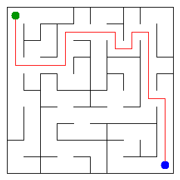

# Assignment 3. Maze Escape

Student ID: 251187
Name: Ilya D.
Group: SE-2511
Maze size (rows x columns): 10x10

This file is the report. Fill it in as you go. How to start: `START_HERE.md`. The task: `docs/Assignment3.pdf`.

## Program output

The 13 lines your program prints on your data (`java -cp out Main`):

    Broken: 99
    Kept: 81
    Last broken wall: 138
    MST cost: 31813
    Heaviest broken wall: 787
    Path length: 24
    DFS visited: 42
    Dead ends: 27
    Zones: 10
    Largest zone: 17
    Is DAG: 0
    Flow stages: 6
    Fastest route cost: 18

My maze:

## Questions

Answer in your own words, two or three sentences each.

Mission 0. What do find and union do, and what makes them fast in your code?
Find looks for the main root of a cell's group, and union joins two groups together if they have different roots. They are fast because find links cells directly to the root, and union always puts the smaller group under the larger one so the tree doesn't get too tall.

Mission 1. Why is Broken always R*C - 1, and Kept always (R-1)*(C-1)?
To connect all RC cells into one path without loops we need cells-1 broken walls. The Kept walls are the amount of inner walls in the grid minus the broken ones.

Mission 2. My MST cost from Kruskal and from Prim, and why they are equal:
Cost is 31813 because all the wall breaking costs are unique, which means there is only one possible cheapest way to build the maze.

Mission 3. Why is there exactly one path between two cells? How did you avoid a stack overflow on a huge maze?
Because the maze is a perfect spanning tree, all cells are connected and there are no circles/loops, leaving only one way to go. Stack overflow is avoided by using an array as a stack instead of using recursion.

Mission 4. Why does the second pass of Kosaraju go on the reversed graph? Why do the slides have no cycle exactly when Zones equals the number of cells?
It needs to stay inside one zone without leaking into already found zones. If the number of zones is equal to number of cells it means every cell has its own zone so nobody can loop back to each other.

Mission 5. Why is it enough to go through the zones in the order of their numbers? What does this pass cost?
Because Kosaraju numbered the zones so that the slides only go from a smaller number to a bigger one, so we can walk through them in order without going back. It only costs O(n+m), because it visits each cell and slide only one time.

## AI use

Used: Gemini, for guidance through the main concepts of used algorithms and principles, helping review some of the code to correct occasional mistakes.

## Timing (Mission 7)

Milliseconds, 5 runs each, from `java -cp out Bench`.

| maze | Kruskal | Prim |
|---|---|---|
| 100 x 100 | | |
| 300 x 300 | | |
| 1000 x 1000 | | |

What do the numbers say about how the time grows? Two or three sentences.

## Complexity

n is the number of cells, m the number of walls (or slides). Fill in every algorithm you wrote.

| algorithm | time | space | assumptions |
|---|---|---|---|
| DSU find and union | | | |
| Kruskal | | | |
| Prim | | | |
| DFS | | | |
| Kosaraju | | | |
| Route in the zone graph | | | |

## Before you submit

- data/walls.txt, data/slides.txt and output/maze.png are in the repository.
- `java tools/Check.java` shows all examples right.
- This README is filled in, the program output and the section AI use included.
- The work is pushed to main (at least one commit per mission) and the repository is public.
- The link is attached in Moodle.
